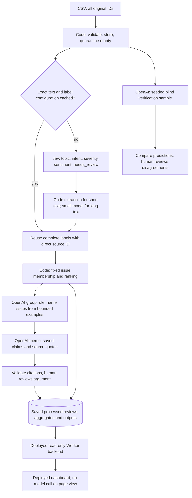

# Architecture and responsibilities

All four roles completed in the real cold pilot; warm replay made zero new calls. Earlier credit, parser and schema failures remain logged separately. Human quality evaluation is still pending. Four distinct model tasks share saved artifacts, never accumulated conversation histories.

| Stage | Input / output | Controls |
|---|---|---|
| Ingestion | Original CSV → SQLite and source profile | Preserve original strings; duplicate IDs fail; empty text quarantined |
| Enrich | Text only → complete labels | One review, five questions per Jev request; <=50 limit respected; no stars or human answers |
| Extraction | Text and labels → verbatim quote/entities | Full text at <=600 characters; exact feature-term matcher; longer text uses bounded OpenAI extraction |
| Verify | Seeded sample, raw text + shared taxonomy → independent predictions | Five of the pilot 100; first labels absent from request; disagreements compared afterward |
| Group | Saved memberships/ranks and up to three examples per issue → names | Model cannot change membership; successful `group` model call required by course checker |
| Rank | Complaint/cancellation memberships → ranking and claims | Integer severity sum; deterministic ties; all original IDs count |
| Memo | Bounded evidence and names → structured recommendation | Numeric claim placeholders resolved by code; validate source IDs; human checks semantic support |

Short-text quotes and the entity vocabulary are a cheap baseline, not established quality. Inspect omitted entities and whether each quote actually supports its labels. Long-text extraction has not been measured: the fixed pilot's longest text is 486 characters. The full source has only seven distinct texts longer than 600 characters (maximum 1,693), as saved in evidence/extraction-routing-profile.json. Their routing cost remains unknown until separately measured; development-only examples should be used for prompt decisions.

## Cost and state

- Exact original text only; no trimming, case folding or translation for reuse. Source ID stays outside the classification prompt.
- Cache namespace includes model, effort, output cap, schema, extraction policy, taxonomy and all four prompts. This conservative version also invalidates enrichment when downstream prompts change.
- Jev labels are incomplete until quote/entities are validated. Every accepted result is saved transactionally, with original source ID and request provenance.
- One worker, bounded transient retries (two) and invalid-output retry (one), 900-second execution limit, 1,200 OpenAI output-token cap. Retry limits may stop with pending records; fix failures before scaling.
- Reserve estimated worst-case cost before dispatch. Save every attempt and raw usage. Missing usage holds its reservation across restarts; uncertain in-flight calls require reconciliation.
- Short extraction uses no generation; grouping and memo occur once per run, not per review. Provider response caches include inputs and config, enabling unchanged downstream replay.
- Current pilot has zero stronger-model fallbacks. The configuration's 1% fallback fraction is a draft scaling assumption, not implemented routing or measured usage.
- No full CSV in a model prompt; local data processing uses zero API tokens. Paid execution needs both explicit CLI flags and local credentials.

## Gates still requiring real evidence

100 cold/warm → inspect quality and all charges → 500 plus human golden evaluation and failure demonstrations → 10,000 measured throughput/updated budget → budgeted final run over the revised 100,000-nonempty scope plus 13 empty quarantines. All 660,622 source IDs remain in the full ingestion store; 560,609 nonempty IDs outside the selected scope are not claimed as classified. The revised assignment also requires a deployed dashboard, backend and database (deployed for the 500 checkpoint; final data/public access pending). Stop on unresolved costs, failures or budget excess; don't infer success from a valid schema.

Full scheduling, representative extraction measurements, conservative time estimates and public submission remain future stages. Numeric citation checks cannot establish causality or prove a business recommendation.
