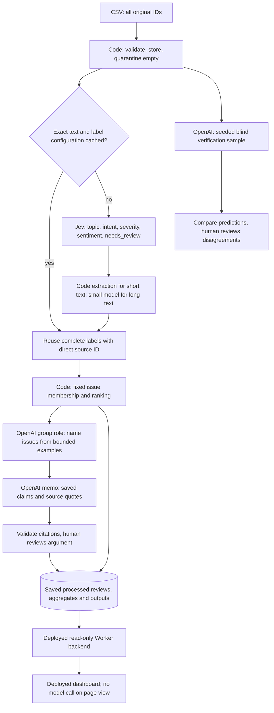

# Architecture and responsibilities

All four roles completed in the final 100,000-review selected scope; the measured warm replay made zero new calls. Earlier credit, parser and schema failures remain logged separately. The student confirmed review of the AI-assisted Golden 50 reference labels; independent human accuracy remains unproven. Four distinct model tasks share saved artifacts, never accumulated conversation histories.

| Stage | Input / output | Controls |
|---|---|---|
| Ingestion | Original CSV → SQLite and source profile | Preserve original strings; duplicate IDs fail; empty text quarantined |
| Enrich | Text only → complete labels | One review, five questions per Jev request; <=50 limit respected; no stars or human answers |
| Extraction | Text and labels → verbatim quote/entities | Full text at <=600 characters; exact feature-term matcher; longer text uses bounded OpenAI extraction |
| Verify | Seeded sample, raw text + shared taxonomy → independent predictions | Five of the fixed 100-review pilot; the final run selected 5,000 original IDs, with 4,990 valid comparisons and 10 visible failures. First labels are absent from verifier requests |
| Group | Saved memberships/ranks and up to three examples per issue → names | Model cannot change membership; successful `group` model call required by course checker |
| Rank | Complaint/cancellation memberships → ranking and claims | Integer severity sum; deterministic ties; all original IDs count |
| Memo | Bounded evidence and names → structured recommendation | Numeric claim placeholders resolved by code; validate source IDs; human checks semantic support |

Short-text quotes and the entity vocabulary are a cheap baseline, not established quality. Inspect omitted entities and whether each quote actually supports its labels. The fixed 100-review pilot did not exercise long-text extraction; its longest text is 486 characters. The full-source routing profile in evidence/extraction-routing-profile.json identifies seven distinct texts over 600 characters, and the completed final ledger captures all actual selected-scope calls.

## Cost and state

- Exact original text only; no trimming, case folding or translation for reuse. Source ID stays outside the classification prompt.
- Cache namespace includes model, effort, output cap, schema, extraction policy, taxonomy and all four prompts. This conservative version also invalidates enrichment when downstream prompts change.
- Jev labels are incomplete until quote/entities are validated. Every accepted result is saved transactionally, with original source ID and request provenance.
- The pilot used one worker; the final selected scope used two workers. Transient retries are bounded to two and invalid-output retry to one; each segment has a 900-second execution limit and a 1,200 OpenAI output-token cap. Failed attempts and unknown usage remain visible.
- Reserve estimated worst-case cost before dispatch. Save every attempt and raw usage. Missing usage holds its reservation across restarts; uncertain in-flight calls require reconciliation.
- Short extraction uses no generation; grouping and memo occur once per run, not per review. Provider response caches include inputs and config, enabling unchanged downstream replay.
- The final configuration used no stronger-model fallback; the earlier 1% projection was a scenario assumption, not actual routing.
- No full CSV in a model prompt; local data processing uses zero API tokens. Paid execution needs both explicit CLI flags and local credentials.

## Completed sequence and remaining interpretation limits

The actual sequence was 100 cold/warm, 500, 10,000, then the revised final 100,000-nonempty selected scope plus 13 empty quarantines. All 660,622 source rows were profiled. The other 560,609 nonempty source IDs are outside the selected classification scope. The final selected run, grouped outputs and memo are saved, and a D1-backed public dashboard serves them through a read-only Worker.

The unmodified instructor checker verifies complete selected classification coverage and ranking arithmetic, but reports `review_required` for six unknown token fields on three failed calls. These unknowns are preserved, not replaced with zero. [Official result](evidence/final-100k/official-check.json); [individual trace](docs/one-review-trace.md). A numeric citation check cannot prove semantic correctness or causality; the student endorsed the product direction, and the edited memo discloses its limits.
